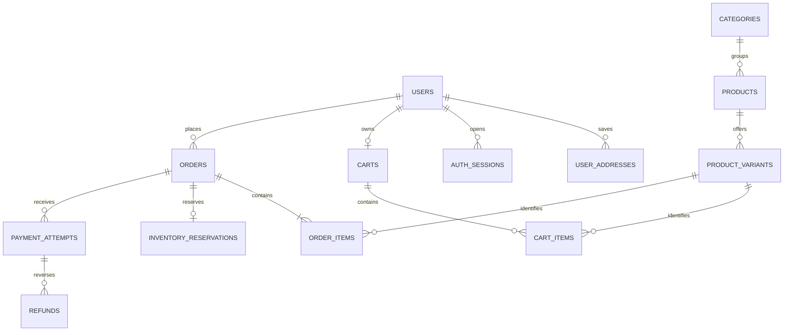

# Database overview

LankaKade uses the `lankakade` schema on MySQL 8.4 or later with InnoDB and `utf8mb4`. The storefront and admin panel access it through the [backend API](./08-backend-api.md). Use the [initial schema](../../backend/database/schema.sql) and migrations for exact columns, indexes, and constraints, and the [backend data dictionary](../../backend/knowledge-base/database-design.md) for a table-by-table reference.

The base schema has 27 tables and two views. Applying all three current migrations gives 31 tables and the same two views. A fresh import seeds one store settings row. Catalog and customer data are created separately through their respective workflows.

## Main relationships



## Schema map

| Domain | Tables and views | Purpose and current use |
| --- | --- | --- |
| Store configuration | `store_settings` | Singleton `id = 1` holds `flat_delivery_fee`. A `NULL` fee makes preview and checkout unavailable. `0.00` configures free delivery. |
| Identity and addresses | `users`, `user_addresses` | Unique account email, role and status, verified email timestamp, and editable saved addresses. Customer reads and writes are scoped to the session's user ID. |
| Authentication | `auth_sessions`, `auth_challenges`, `admin_mfa`, `admin_recovery_codes`, `auth_rate_limits` | Session and challenge token hashes, expiry and revocation, encrypted admin authenticator secret, one-time recovery code hashes, and shared rate-limit counters. Migration 001 limits the database to one admin. The challenge schema also permits sign-in OTP, which has no customer API flow. |
| Catalog | `categories`, `products`, `product_images`, `product_image_files` | A product belongs to one category. Images have an explicit order and use external URLs or managed WebP bytes. Archive timestamps preserve catalog references while controlling public visibility. |
| Options and variants | `product_options`, `product_option_values`, `product_variants`, `variant_option_values` | A variant is a sellable SKU with its own RON price, stock, low-stock threshold, and archive state. Its option selections belong to its own product, and each combination is unique within that product. |
| Cart | `carts`, `cart_items` | One cart per user, keyed by `user_id`, and one line per variant in that cart. The cart revision advances with a real item change. Current prices come from variants. |
| Orders | `orders`, `order_items`, `order_status_history` | Checkout writes the buyer and address snapshot, order totals, cart revision, idempotency key and request hash, item snapshots, and status history. The customer API currently exposes owner-scoped order detail. |
| Inventory | `inventory_reservations`, `inventory_movements` | One reservation per order covers all its lines. Movements record on-hand and reserved deltas with unique operation keys. Catalog opening stock, local checkout reservations, expiry, and internal verified capture handling use these records. |
| Payments | `payment_attempts`, `payment_webhook_events`, `refunds` | Supports multiple attempts, at most one accepted capture per order, unique provider event IDs, and partial or full refunds. The provider integration and HTTP webhook are pending. |
| Returns | `order_returns`, `return_items` | Links returns to the order and its original lines. Tracks requested, approved, received, and restocked units. Return endpoints are pending. |
| Operations | `low_stock_alerts`, `low_stock_email_outbox`, `admin_audit_log`, `v_low_stock`, `v_sales_activity` | Keeps one open alert per variant and one email job per alert. The views expose low-stock state and accepted captures minus succeeded refunds. Admin catalog actions write audit records. Email delivery for low-stock jobs and reporting endpoints are pending. |

## How data changes during shopping

1. **Browse a product.** Product details join its category, ordered images, options, and active variants. Public catalog reads require the product and category to be active. MySQL computes `available_stock = stock_on_hand - stock_reserved` and enforces that reserved stock cannot exceed on-hand stock. Sold-out variants can still appear. A default variant covers products without choices.
2. **Add a SKU to the cart.** A cart line points to `product_variants.id`. It stores a quantity and does not reserve stock. Revisions let checkout detect a cart that changed after preview. An archived item can remain in a customer's cart until they remove it.
3. **Preview delivery.** The API checks a saved address belongs to the customer and has country code `RO`, checks live availability and prices, and adds the configured flat fee once. Preview does not reserve stock. The returned revision and total tie the next request to what the customer reviewed.
4. **Create a local test order.** Within one transaction, checkout locks the cart and relevant catalog records, rechecks availability and totals, writes the order and its item snapshots, and increases reserved stock. The 15-minute reservation, movement entries, initial status, and any low-stock changes commit together. The unique customer and checkout key pair makes an identical retry return the same order.
5. **Resolve the reservation.** The expiry worker releases reserved stock, moves the order from `awaiting_payment` to `expired`, and preserves the cart. The internal verified payment handler can consume an active reservation, decrement both on-hand and reserved quantities, and move the order to `confirmed` with fulfillment `processing`. It clears the cart only if its revision still matches. Expiry and payment use the same order and reservation locks. A late, duplicate, or mismatched capture does not confirm a second sale or consume stock again.

The order stores its own contact and address fields. Each line stores the product name, SKU, selected option labels and values, unit price, and quantity. Catalog edits, price changes, and saved address changes do not rewrite that history. Money uses exact `DECIMAL` fields, amounts and unsigned IDs cross the API as strings, and the backend uses UTC for database sessions.

Order and fulfillment statuses are separate. The schema permits `awaiting_payment` with `not_started`, `confirmed` with `processing`, `dispatched`, or `delivered`, and `expired` or `cancelled` with fulfillment `cancelled`. Shipment fields are on the order row. The [backend system flows](../../backend/knowledge-base/system-flows.md) describe the intended fulfillment, cancellation, return, and reconciliation workflows.

## Local database setup

Use a local or disposable MySQL instance with synthetic data. Run the scripts in the order below in MySQL Workbench or the MySQL client as the schema owner.

| Step | Script | Effect |
| --- | --- | --- |
| 1 | [Base schema](../../backend/database/schema.sql) | Creates the database, base tables, views, and store settings row. Reruns preserve the configured delivery fee. |
| 2 | [001 Auth and accounts](../../backend/database/migrations/001_auth_and_accounts.sql) | Adds the single-admin constraint, session MFA timestamp, MFA and recovery tables, and rate-limit storage. Apply once. |
| 3 | [002 Product image files](../../backend/database/migrations/002_product_image_files.sql) | Adds managed product image storage. |
| 4 | [003 Checkout lookup](../../backend/database/migrations/003_checkout_lookup.sql) | Adds the order lookup index for user, status, and cart revision. Apply once. |
| 5 | [Auth](../../backend/database/permissions/auth_runtime.sql), [catalog](../../backend/database/permissions/catalog_runtime.sql), and [orders](../../backend/database/permissions/orders_runtime.sql) grants | Creates the runtime roles with scoped privileges. Grant the applicable roles to the dedicated API login and activate them by default. |

The normal API login uses `lankakade_auth_runtime`, `lankakade_catalog_runtime`, and `lankakade_orders_runtime` together. For a disposable local checkout environment, add `lankakade_checkout_runtime`, configure the flat delivery fee in `store_settings`, set `CHECKOUT_TEST_MODE=true` with a loopback `HOST`, and start `npm run reservations:worker` alongside the API. The `lankakade_payment_runtime` grant is for disposable integration tests until the verified gateway is wired. See the [backend setup](../../backend/knowledge-base/README.md#create-the-database-in-mysql-workbench) and [checkout database setup](../../backend/knowledge-base/cart-and-checkout.md#database-setup) for role assignment and test instructions.

To inspect setup, use the schema owner or an operator login with read access to the full schema. The migrated database should report 31 base tables, two views, and one settings row. An empty fee is expected on a fresh database.

```sql
SELECT TABLE_TYPE, COUNT(*) AS object_count
FROM information_schema.TABLES
WHERE TABLE_SCHEMA = 'lankakade'
GROUP BY TABLE_TYPE;

SELECT id, flat_delivery_fee
FROM lankakade.store_settings
WHERE id = 1;
```

Use the admin API to create an active category, a product, and at least one active variant with a positive opening quantity when testing an in-stock storefront journey. This also exercises inventory movements and audit writes. See the [catalog walkthrough](../../backend/knowledge-base/postman-guide.md#verify-the-product-catalog).
